# Simple Gantt

A simple, beautiful Gantt chart for Obsidian. Plan a project (or a whole dissertation year) on one clear timeline, then export a print-ready chart for your report.

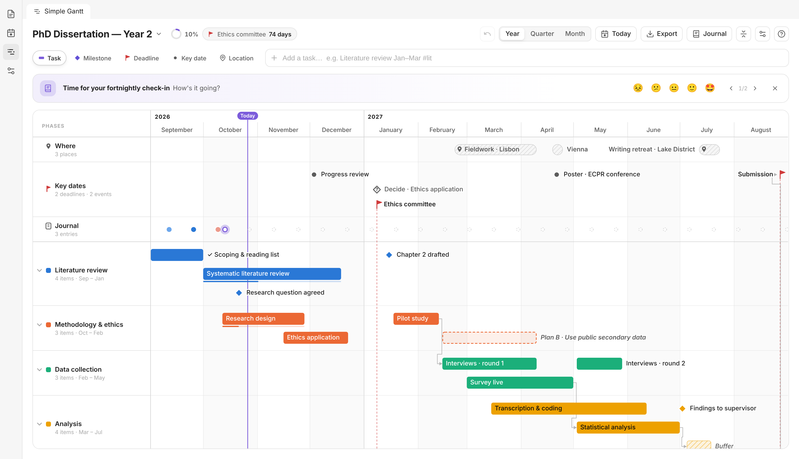

## Features

- **One click away.** A button in the left ribbon opens the timeline in its own tab.
- **Year overview first.** Opens on the whole project, with a today line. Zoom to **Quarter** or **Month** with a smooth animation, or Ctrl/Cmd + scroll.
- **Five kinds of items**
  | | Item | Used for |
  |---|---|---|
  | ▬ | **Task** | Work over a period, grouped into colour-coded phases. Optional progress. |
  | ◆ | **Milestone** | A moment you reach, e.g. "Chapter 2 drafted". |
  | ⚑ | **Deadline** | A hard date. Drawn as a red flag with a dashed rule through the whole chart. |
  | ● | **Key date** | Meetings, reviews, conferences. |
  | ⌖ | **Location** | Where you'll be: fieldwork, trips, retreats. |
- **Add things in one line** with the quick-add bar. A live preview shows exactly what will be created.
- **Drag to edit.** Move bars, resize them from either end, or drag a task into another phase. Drag across an empty row to draw a task, or double-click to drop a milestone. While you drag, date guides show exactly where it will land. Empty rows say how to start, and each row has a **+** to add to it.
- **Links that keep the order.** Hover a bar and drag the dot at its end onto what comes next, for example *Analysis starts after Data collection*. Arrows show the chain. When something slips, everything linked after it moves too. If a deadline would be missed, the arrow turns red and you get a warning.
- **Fold phases.** Click a phase to fold it into one summary bar that shows overall progress. Press **F** to fold everything for a clean overview, or for a short version of the chart in your dissertation.
- **Buffer time.** Plan slack for the delays that always come, with a hatched bar (`~` in quick add). You can also use "Add 2 weeks of buffer after this" on any task. Guides for PhD planning commonly suggest a few weeks of buffer per phase.
- **Keyboard.** ←/→ move the selected item by a day (Shift: a week), Alt+←/→ resize it, and ↑/↓ move it to another phase. Press **?** for a card with every gesture.
- **Comfortable or Compact spacing**, set in project settings.
- **Use only what you need.** Under project settings → **Features**, switch tools on or off for each timeline: Links, Progress, Reminders, Key dates, Locations, Buffer time, Plan B, Journal and Celebrations. You can also pick a preset, **Essentials** or **Everything**. Switching something off only hides it; your data stays in the note. A new **Blank** project starts with the essentials, and **Dissertation** starts with everything.
- **Side panel** for details: dates, phase, progress, a linked note, and notes.
- **Undo / redo** with Ctrl+Z / Ctrl+Shift+Z.
- **Tick things off: "How did it go?"** Mark a task, milestone or deadline done with the checkbox or <kbd>Space</kbd>. You get a burst of confetti 🎉, then a quick reflection: a mood face, a few words, and whether you finished early or late.
- **Plan B / decision points.** Give any item a contingency: *"If this isn't done by 8 Jan, then I'll use public secondary data instead."*
  - The decision date appears among the key dates, and the alternative appears as a dashed ghost bar.
  - When the date arrives, Simple Gantt asks you to decide: **Switch to Plan B** (the original stays, faded, as a record of the change) or **Still on track**.
- **When things slip.** Push an item and everything after it by +1 week, +2 weeks or +1 month in one click, optionally only within its phase. You can also hold <kbd>Shift</kbd> while dragging a bar.
- **Journal with check-ins.** Choose a rhythm (weekly, every two weeks or monthly):
  - A Journal row on the chart shows your entries, coloured by mood, and your upcoming check-ins.
  - A nudge appears when one is due.
  - The note box has mood faces and rotating writing prompts.
  - "How did it go?" reviews show up in the same feed.
  - **Save as note** turns the whole journal into a Markdown note, which is handy for the reflective chapter of a dissertation.
- **Nudges** above the chart: *Did you reach "Chapter 2 drafted"?*, *Decision time*, *Time for your check-in*, *Ethics committee is in 5 days*.
- **At a glance:** an overall progress ring and a countdown to the next deadline in the toolbar.
- **Export** as a high-resolution PNG or a vector SVG. Exports always use a clean white print style with a title block and legend, ready for a dissertation appendix.
- **Your data is a normal note.** Each timeline is a Markdown file with a readable YAML block. It's backed up and synced with your vault, works with git, and survives if you uninstall the plugin.
- Follows your Obsidian theme (light and dark), and works on mobile.

| Quick add | Editing | Dark, quarter zoom |
|---|---|---|
| 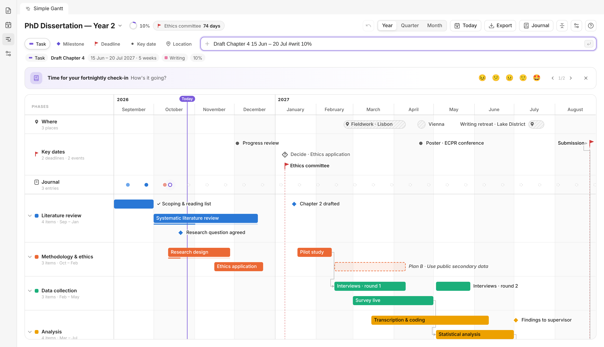 | 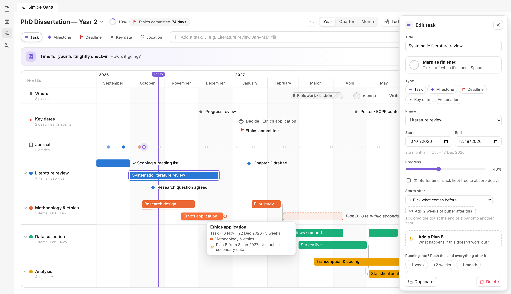 | 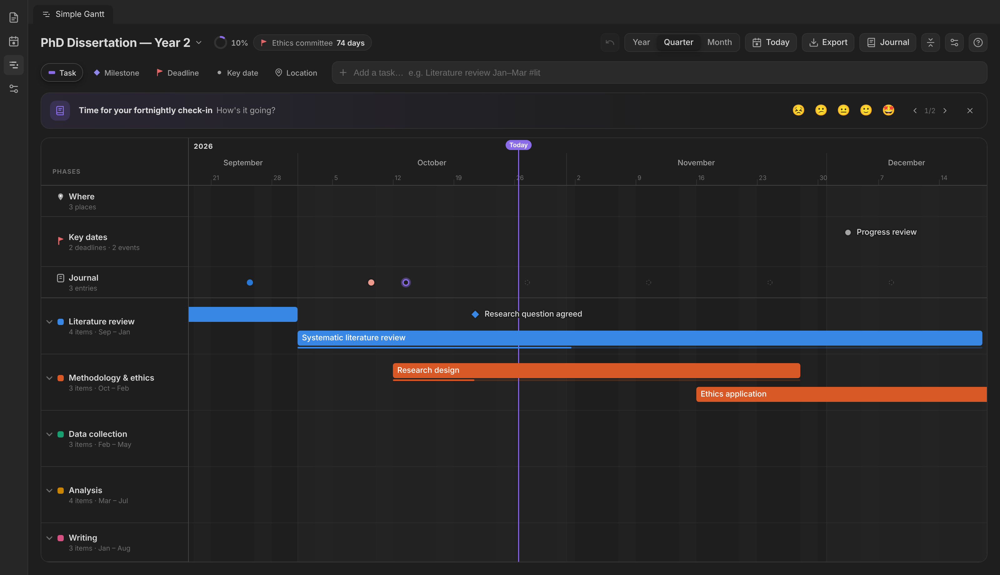 |

| Done 🎉 How did it go? | Plan B | Journal |
|---|---|---|
| 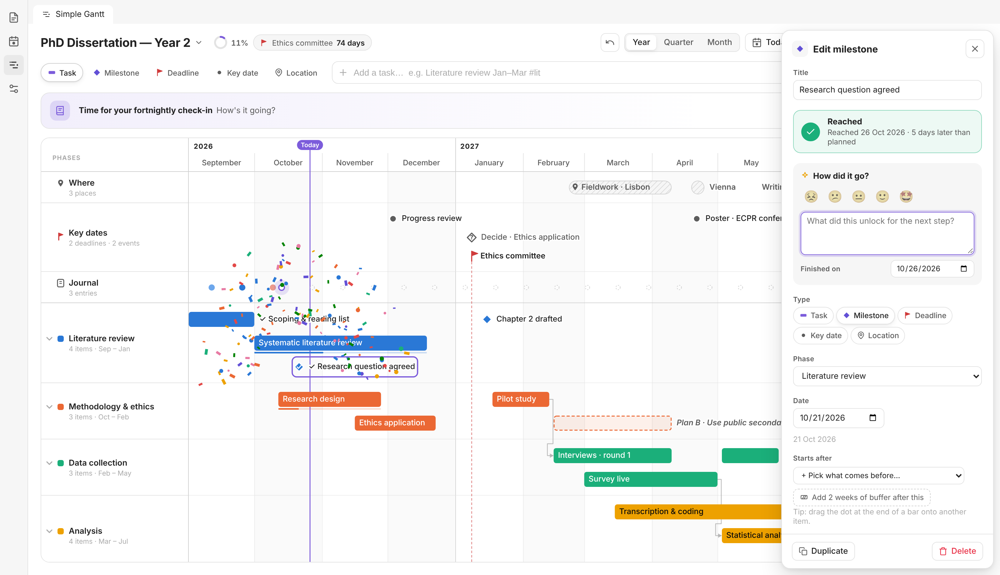 | 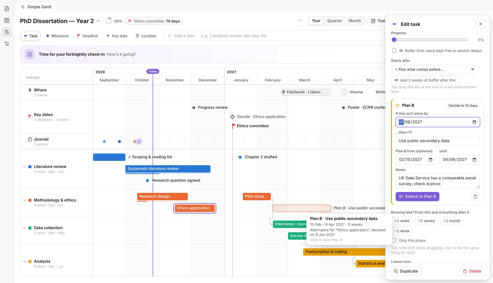 | 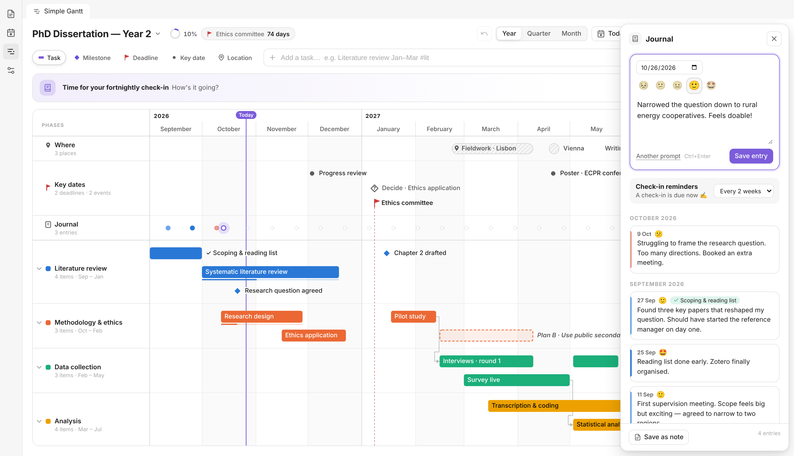 |

| Link by dragging | Folded phases | Every gesture (?) |
|---|---|---|
| 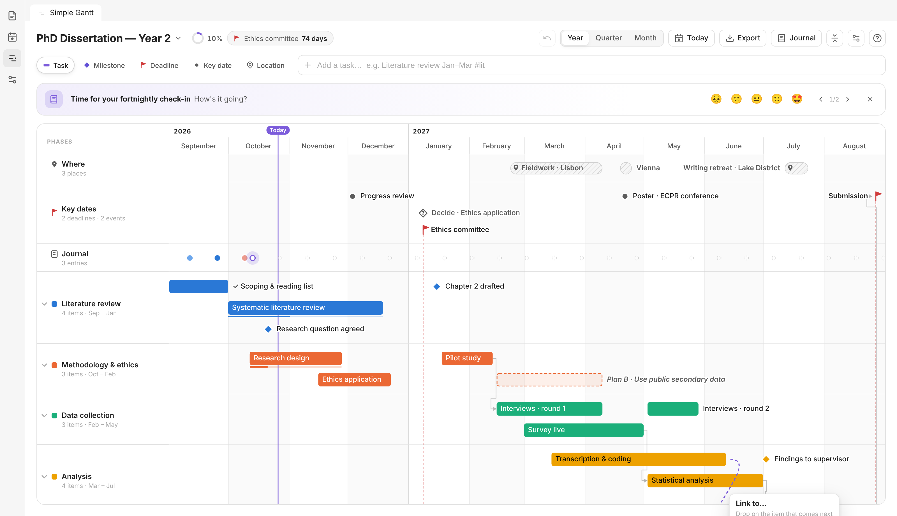 | 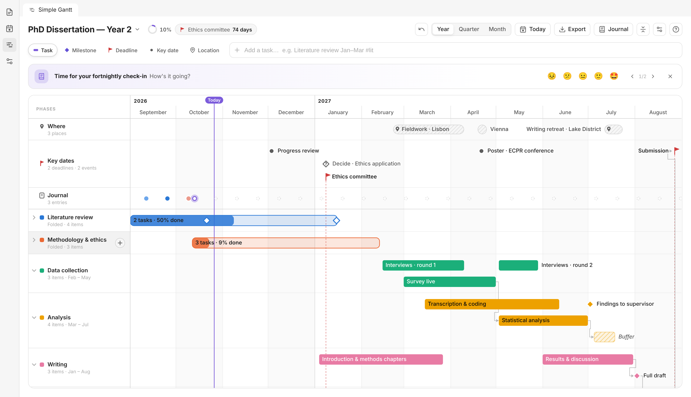 | 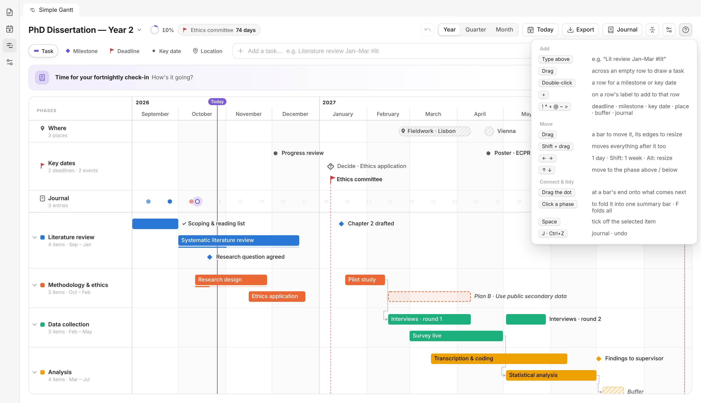 |

| Features on/off | A fresh, calm timeline |
|---|---|
| 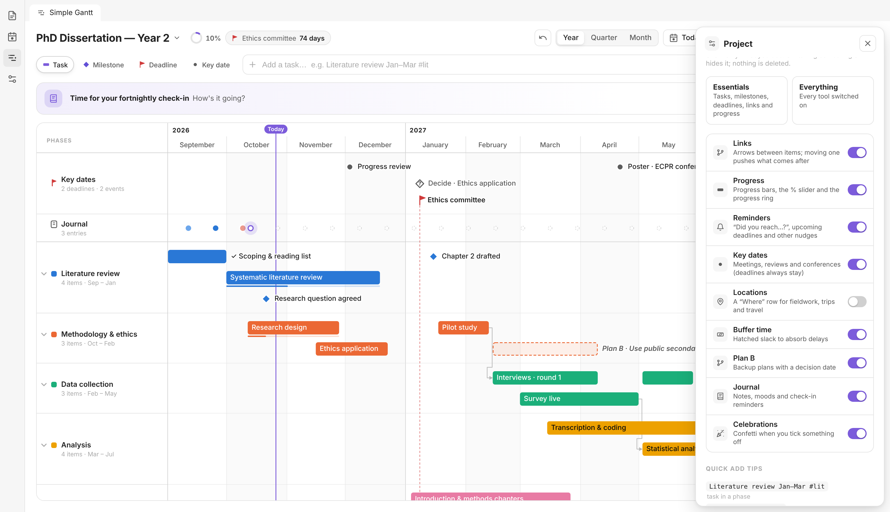 | 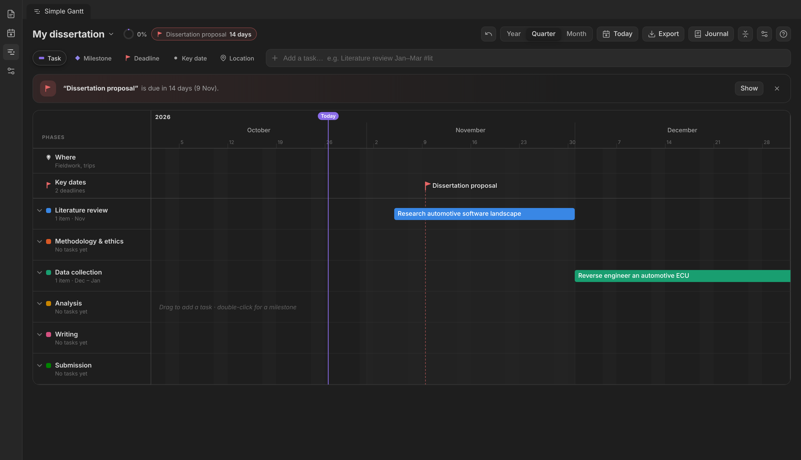 |

### The print export

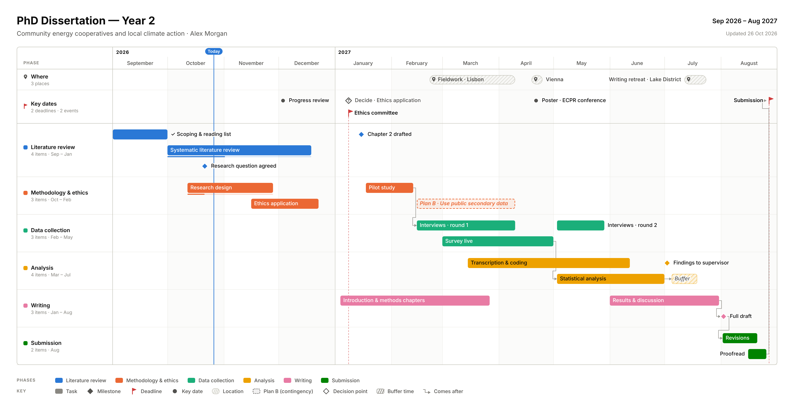

## Quick-add syntax

Type a title and a date; everything else is optional.

| You type | You get |
|---|---|
| `Literature review Jan–Mar #lit` | Task from 1 Jan to 31 Mar in the phase starting with "lit" |
| `Pilot study 18 Jan for 4 weeks 30%` | Task with a duration and 30% progress |
| `Interviews 15–20 May` | Task over those days |
| `!Ethics submission 15 Feb` | Deadline (`!`) |
| `*Chapter 2 drafted 20 Jan` | Milestone (`*`) |
| `+Supervisor meeting 3 Dec` | Key date (`+`) |
| `@Fieldwork Lisbon 22 Feb – 9 Apr` | Location (`@`) |
| `Teaching Sep–Dec #teaching` | Creates the phase "Teaching" if it doesn't exist yet |
| `> Great supervisor meeting today` | A journal entry for today (`>`) |
| `~ 1–14 Jul #analysis` | Two weeks of buffer time (`~`) |

- **Dates:** `15 Feb`, `Feb 15`, `February`, `Jan–Mar 2027`, `2027-02-15`, `15/2/2027` (day first), `today`, `tomorrow`.
- **Years:** if you leave the year out, it's picked so the date falls inside the project.
- **Types from words:** "deadline" or "due" makes a deadline, and "meeting", "conference" or "viva" makes a key date. You can also pick the type with the chips beside the input.
- **Shortcuts:** <kbd>Enter</kbd> adds the item. <kbd>Shift</kbd>+<kbd>Enter</kbd> adds it and opens it for editing. <kbd>/</kbd> jumps to the input.
- **On the board:** <kbd>Space</kbd> ticks off the selected item, <kbd>J</kbd> opens the journal, <kbd>Delete</kbd> removes the selection, and <kbd>Esc</kbd> closes panels.

## Where your data lives

New timelines are created in the `Gantt/` folder (you can change this in settings). A timeline note looks like this:

````markdown
---
simple-gantt: true
---

```simple-gantt
title: PhD Dissertation — Year 2
start: '2026-09-01'
end: '2027-08-31'
phases:
  - id: literature
    name: Literature review
    color: blue
items:
  - title: Systematic literature review
    type: task
    phase: literature
    start: '2026-10-01'
    end: '2026-12-18'
    progress: 40
    planB:
      by: '2026-12-01'
      title: Narrow the review to 2015 onwards
  - title: Research question agreed
    type: milestone
    phase: literature
    start: '2026-10-21'
    done: true
    doneOn: '2026-10-26'
    review:
      mood: 4
      text: Took two extra meetings, but it's much sharper now.
checkin: fortnightly
journal:
  - date: '2026-10-09'
    mood: 2
    text: Struggling to frame the research question.
```
````

- **Reading view:** the block renders as a chart preview, with a button that opens the full board.
- **Hand edits:** you can edit the YAML by hand, and the board reloads.
- **Embedding:** copy the block into any other note to show the chart there.

## Commands

- **Open timeline**
- **New dissertation timeline** / **New blank timeline**
- **Open this note as a timeline**

## Install

Until the plugin is listed in Community plugins:

1. Download `main.js`, `manifest.json` and `styles.css` from the latest release.
2. Put them in `<your vault>/.obsidian/plugins/simple-gantt/`.
3. Enable **Simple Gantt** under Settings → Community plugins.

## Development

```bash
npm install
npm run dev          # rebuilds main.js on change; symlink this folder into a test vault's plugins dir
npm run build        # type-check + production build
npm test             # parser, nudge/journal and round-trip tests + an end-to-end run against an in-memory Obsidian mock
npm run screenshots  # regenerates the images in docs/images
```

`dev/preview.html` (after `npm run preview`) runs the board in a plain browser with sample data.

Code layout:

- `src/core/` holds pure logic: dates, the quick-add parser, layout, SVG rendering, and YAML (de)serialisation.
- `src/ui/board.ts` is the interactive board.
- `src/view.ts` and `src/main.ts` connect it all to Obsidian.

## License

[MIT](LICENSE)
