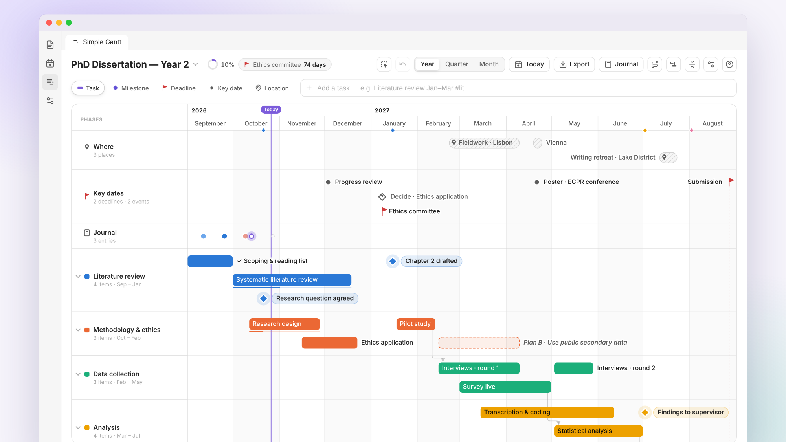
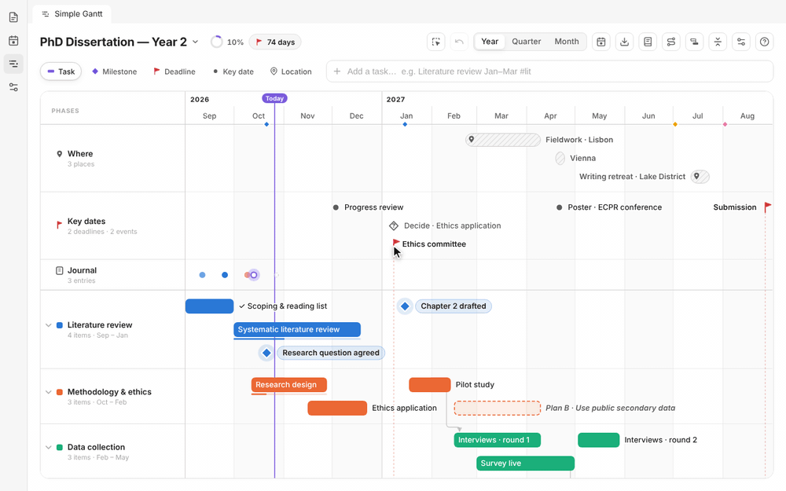
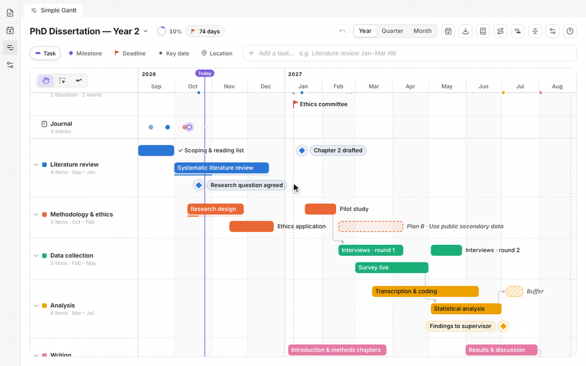
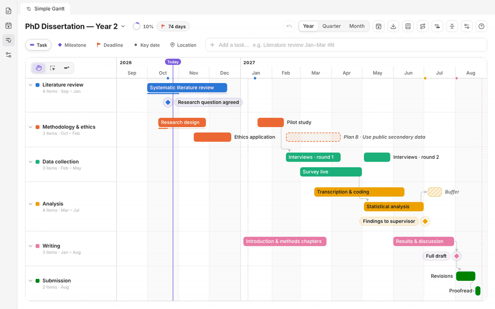
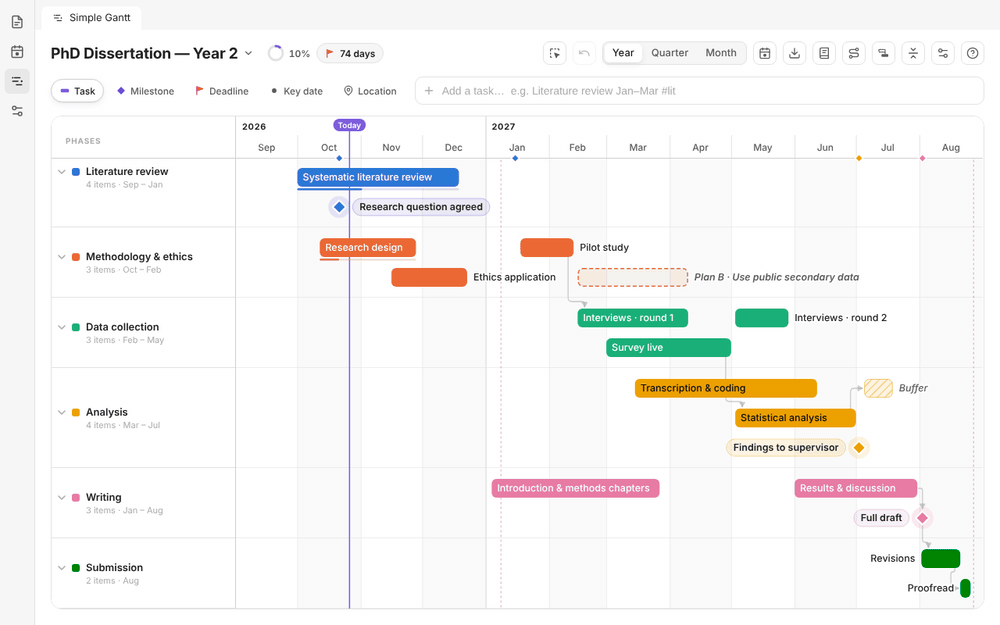
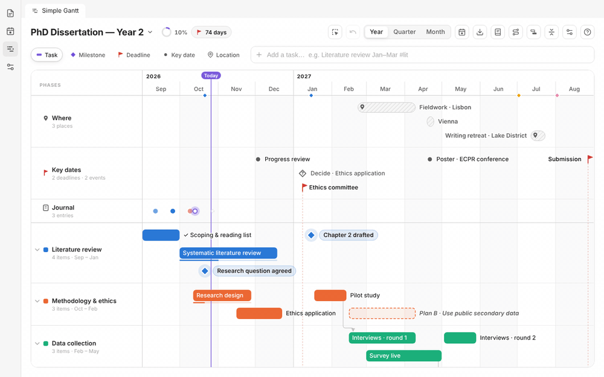
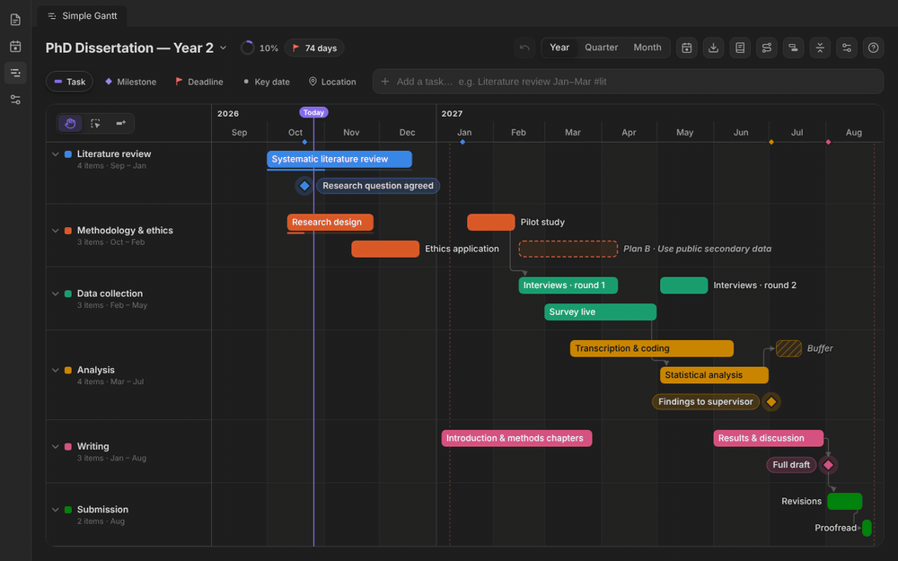

<p align="center">
  <picture>
    <source media="(prefers-color-scheme: dark)" srcset="docs/images/hero-dark.png">
    
  </picture>
</p>

<h1 align="center">Simple Gantt</h1>

<p align="center">
  <b>A calm, beautiful Gantt chart for Obsidian.</b><br>
  Plan a project, or a whole dissertation year, on one timeline. Your plan stays a normal note,<br>
  and one click gives you a print-ready chart for your report.
</p>

<p align="center">
  <a href="https://github.com/Nexziz/simple-gantt/releases/latest"></a>
  <a href="https://github.com/Nexziz/simple-gantt/releases"></a>
  
  
  <a href="LICENSE"></a>
</p>

<p align="center">
  <a href="#see-it-in-action">See it in action</a> ·
  <a href="#features">Features</a> ·
  <a href="#quick-add">Quick add</a> ·
  <a href="#keyboard-and-mouse">Keyboard &amp; mouse</a> ·
  <a href="#where-your-data-lives">Your data</a> ·
  <a href="#install">Install</a>
</p>

<table>
  <tr>
    <td width="33%" valign="top">
      <h3>⚡ One line to add anything</h3>
      Type <code>Interviews 3–28 May #data</code> and it lands in the right phase on the right dates. Deadlines, milestones, places and journal notes work the same way.
    </td>
    <td width="33%" valign="top">
      <h3>🖐️ Drag, link, tick off</h3>
      Move and resize bars, select several like on a Canvas, and link steps so a delay pushes what comes after. Ticking something off gets you confetti.
    </td>
    <td width="33%" valign="top">
      <h3>📄 Just a note</h3>
      Each timeline is a Markdown note with readable YAML. It syncs, works with git, and is still there if you ever uninstall the plugin. No accounts, no network.
    </td>
  </tr>
</table>

## See it in action

### Add things in one line
The live preview shows exactly what you'll get before you press <kbd>Enter</kbd>.



### Drag to move, resize and push
While you drag, guides show the new dates. Hold <kbd>Shift</kbd> to move everything after it too.



### Link steps so the order holds
Drag the dot at the end of a bar onto what comes next. Move the first step and the next one follows. Click a line to detach it.


### Select several, like on a Canvas
Use the select tool (<kbd>V</kbd>) or <kbd>Shift</kbd>-drag on an empty spot to draw a box. Drag one item and the whole group moves.



### Right-click menus and renaming in place
Every item, link and row has a menu. Double-click an item (or press <kbd>F2</kbd>) to rename it right on the chart.



### Tick things off, then ask "how did it go?"
Confetti, a mood and a line of reflection, collected in a journal you can save as a note for your reflective chapter.


### Zoom and fold
Year, quarter or month, with smooth zooming. Fold a phase into one summary bar, or press <kbd>F</kbd> to fold everything.



### Critical path and plan vs. reality
<kbd>C</kbd> highlights the chain with the least slack before a deadline. <kbd>B</kbd> compares today's chart with the plan you saved, showing where everything was planned and how far it moved.



## Features

<details open>
<summary><b>Plan</b></summary>

- **Year overview first.** The board opens on the whole project with a today line. Zoom to **Quarter** or **Month**, or use Ctrl/Cmd + scroll.
- **Five kinds of items**

  | | Item | Used for |
  |---|---|---|
  | ▬ | **Task** | Work over a period, grouped into colour-coded phases. Optional progress. |
  | ◆ | **Milestone** | A moment you reach, e.g. "Chapter 2 drafted". |
  | ⚑ | **Deadline** | A hard date: a red flag with a dashed rule through the whole chart. |
  | ● | **Key date** | Meetings, reviews, conferences. |
  | ⌖ | **Location** | Where you'll be: fieldwork, trips, retreats. |
- **Quick add** understands dates, durations, phases, types and progress (see [Quick add](#quick-add)).
- **Right-click an empty row** to add a task, milestone, deadline or place exactly there, with its name ready to type.
- **Buffer time:** plan slack for the delays that always come (hatched bars, `~` in quick add).
- **Plan B / decision points:** *"If this isn't done by 8 Jan, I'll use public data instead."* When the date comes, you decide: switch to Plan B (the original stays, faded, as a record) or carry on.
- **Templates:** *Dissertation* (twelve months of research phases) or *Blank*.
</details>

<details open>
<summary><b>Move &amp; connect</b></summary>

- **Drag** bars to move them, drag their edges to resize, or drag a task into another phase. Hold <kbd>Shift</kbd> to move everything after it too.
- **Select several:** use the select tool (<kbd>V</kbd>), <kbd>Shift</kbd>-drag a box, <kbd>Shift</kbd>/<kbd>Ctrl</kbd>-click, or press <kbd>Ctrl</kbd>+<kbd>A</kbd>. A small bar moves the selection by a week, links it in date order, ticks it off, duplicates or deletes it.
- **Links** keep the order: when something slips, everything linked after it moves too. Arrows have clean right angles, enter milestones from the top and leave from the bottom. If a deadline would be missed, the arrow turns red and you get a warning.
- **Detach a link** by clicking its line, then **×** or <kbd>Delete</kbd>.
- **Rename in place** by double-clicking or pressing <kbd>F2</kbd>. **Duplicate** with <kbd>Ctrl</kbd>+<kbd>D</kbd>. **Undo** anything with <kbd>Ctrl</kbd>+<kbd>Z</kbd>.
- **Fold phases** into summary bars that show their overall progress.
</details>

<details open>
<summary><b>Stay on track</b></summary>

- **Slack:** hover any linked item to see how long it can slip before it hits a deadline, e.g. *"2 weeks of slack before Submission"*.
- **Critical path** (<kbd>C</kbd>) highlights the chain with the least slack and fades the rest.
- **Saved plan** (<kbd>B</kbd>): save your plan once, and later see where each item was planned (dashed outlines), how far it moved, and a summary of what's late, early or new. This is useful for the "plan vs. reality" part of a dissertation.
- **Nudges** above the chart: *Did you reach "Chapter 2 drafted"?*, *Decision time*, *Ethics committee is in 5 days*.
- **At a glance:** a progress ring and a countdown to the next deadline in the toolbar.
</details>

<details open>
<summary><b>Reflect</b></summary>

- **Tick things off** with the checkbox or <kbd>Space</kbd>, then answer *"How did it go?"* with a mood and a few words.
- **Journal with check-ins** (weekly, every two weeks or monthly) with mood faces and rotating prompts. Your entries appear on the chart.
- **Save the journal as a note:** the whole journal becomes Markdown, ready for your reflective chapter.
</details>

<details open>
<summary><b>Share &amp; export</b></summary>

- **PNG or SVG** in a clean, white print style with a title block and a legend. You can include the saved plan for a "planned vs. actual" figure.
- **Markdown table or CSV** of the whole plan, for an appendix or a spreadsheet.
- **Reading view:** the note's block renders as a chart preview, and you can copy it into any other note.
</details>

<details>
<summary><b>Make it yours</b></summary>

- **Use only what you need:** under project settings → **Features**, switch Links, Progress, Reminders, Key dates, Locations, Buffer time, Plan B, Journal and Celebrations on or off, or pick **Essentials** or **Everything**. Switching something off only hides it; your data stays.
- **Comfortable or Compact** spacing.
- Follows your Obsidian theme (light and dark), and works on mobile.
</details>

| Print export | Dark, quarter zoom | Journal |
|---|---|---|
|  |  |  |

| Plan B | Editing | Features on/off |
|---|---|---|
|  |  |  |

## Quick add

Type a title and a date; everything else is optional.

| You type | You get |
|---|---|
| `Literature review Jan–Mar #lit` | Task from 1 Jan to 31 Mar in the phase starting with "lit" |
| `Pilot study 18 Jan for 4 weeks 30%` | Task with a duration and 30% progress |
| `Interviews 15–20 May` | Task over those days |
| `!Ethics submission 15 Feb` | Deadline (`!`) |
| `*Chapter 2 drafted 20 Jan` | Milestone (`*`) |
| `+Supervisor meeting 3 Dec` | Key date (`+`) |
| `@Fieldwork Lisbon 22 Feb – 9 Apr` | Location (`@`) |
| `Teaching Sep–Dec #teaching` | Creates the phase "Teaching" if it doesn't exist yet |
| `> Great supervisor meeting today` | A journal entry for today (`>`) |
| `~ 1–14 Jul #analysis` | Two weeks of buffer time (`~`) |

- **Dates:** `15 Feb`, `Feb 15`, `February`, `Jan–Mar 2027`, `2027-02-15`, `15/2/2027` (day first), `today`, `tomorrow`.
- **Years:** if you leave the year out, it's picked so the date falls inside the project.
- **Types from words:** "deadline" or "due" makes a deadline; "meeting", "conference" or "viva" makes a key date.
- <kbd>Enter</kbd> adds the item, <kbd>Shift</kbd>+<kbd>Enter</kbd> adds it and opens it, and <kbd>/</kbd> jumps to the input.

## Keyboard and mouse

| | |
|---|---|
| **Drag** an empty row | Draw a task |
| **Double-click** an empty row | Add a milestone or key date |
| **Double-click** an item · <kbd>F2</kbd> | Rename it in place |
| **Right-click** | The menu for an item, a link or a row |
| <kbd>V</kbd> · <kbd>Shift</kbd> + drag | Select tool · draw a selection box |
| <kbd>Shift</kbd>/<kbd>Ctrl</kbd> + click · <kbd>Ctrl</kbd>+<kbd>A</kbd> | Add to the selection · select everything |
| <kbd>←</kbd> <kbd>→</kbd> | Move by a day (<kbd>Shift</kbd>: a week; <kbd>Alt</kbd>: resize) |
| <kbd>↑</kbd> <kbd>↓</kbd> | Move to the phase above or below |
| <kbd>Space</kbd> | Tick off |
| <kbd>Ctrl</kbd>+<kbd>D</kbd> · <kbd>Delete</kbd> | Duplicate · delete (the selected link: unlink) |
| <kbd>C</kbd> · <kbd>B</kbd> | Critical path · compare with the saved plan |
| <kbd>F</kbd> · <kbd>J</kbd> | Fold all phases · journal |
| <kbd>Ctrl</kbd>+<kbd>Z</kbd> · <kbd>Ctrl</kbd>+<kbd>Shift</kbd>+<kbd>Z</kbd> | Undo · redo |
| <kbd>?</kbd> | A card with every gesture |

## Where your data lives

New timelines are created in the `Gantt/` folder (you can change this in settings). A timeline note looks like this:

````markdown
---
simple-gantt: true
---

```simple-gantt
title: PhD Dissertation — Year 2
start: '2026-09-01'
end: '2027-08-31'
phases:
  - id: literature
    name: Literature review
    color: blue
items:
  - title: Systematic literature review
    type: task
    phase: literature
    start: '2026-10-01'
    end: '2026-12-18'
    progress: 40
    planB:
      by: '2026-12-01'
      title: Narrow the review to 2015 onwards
    id: lit-review
  - title: Research question agreed
    type: milestone
    phase: literature
    start: '2026-10-21'
    done: true
    doneOn: '2026-10-26'
    review:
      mood: 4
      text: Took two extra meetings, but it's much sharper now.
    id: question
checkin: fortnightly
baseline:
  saved: '2026-09-01'
  items:
    lit-review: 2026-10-01/2026-12-04
    question: 2026-10-21
```
````

- **Hand edits:** you can edit the YAML yourself; the board reloads.
- **Embedding:** copy the block into any other note to show the chart there.
- **Privacy:** everything stays in your vault. The plugin makes no network requests.

## Install

Until Simple Gantt is listed in Community plugins:

- **With [BRAT](https://github.com/TfTHacker/obsidian42-brat):** add the beta plugin `Nexziz/simple-gantt`.
- **By hand:** download `main.js`, `manifest.json` and `styles.css` from the [latest release](https://github.com/Nexziz/simple-gantt/releases/latest), put them in `<your vault>/.obsidian/plugins/simple-gantt/`, and enable **Simple Gantt** under Settings → Community plugins.

Then click the timeline button in the left ribbon, or run **Simple Gantt: New dissertation timeline** from the command palette.

**Commands:** Open timeline · New dissertation timeline · New blank timeline · Open this note as a timeline

## Development

```bash
npm install
npm run dev          # rebuilds main.js on change; symlink this folder into a test vault's plugins dir
npm run build        # type-check + production build
npm test             # unit tests + an end-to-end run in Chromium against an in-memory Obsidian mock
npm run screenshots  # regenerates the screenshots in docs/images
npm run gifs         # records the GIFs in docs/gifs and the hero images (needs ffmpeg)
```

`dev/preview.html` (after `npm run preview`) runs the board in a plain browser with sample data.

- `src/core/` holds the logic: dates, the quick-add parser, layout, links and slack, the saved plan, SVG rendering, and YAML (de)serialisation.
- `src/ui/board.ts` is the interactive board.
- `src/view.ts` and `src/main.ts` connect it all to Obsidian.

## License

[MIT](LICENSE)
